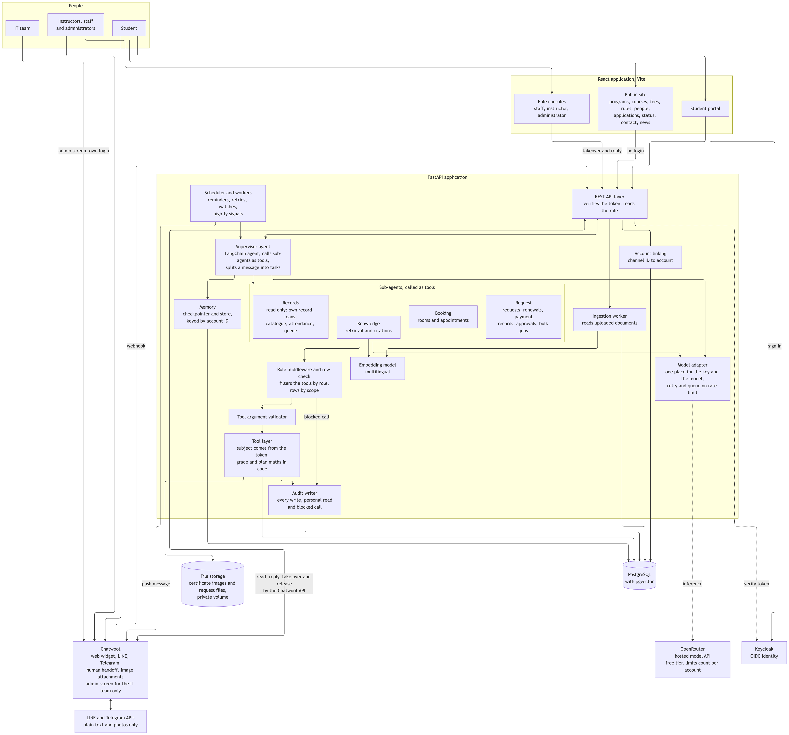

# Smart University Website

A university student services portal where a student does things by conversation instead of by moving between separate systems. The university in our documents is fictional. It is called Thales University.

This is a coursework project for IT Project I and II (BC362916 and BC362914) at Krirk University. It is also designed so that a real university can adopt it. The university supplies its own documents, student data, identity provider and channel accounts.

## The problem

We reviewed the public websites of 17 universities, 12 in Thailand and 5 abroad, on 5 and 6 October 2026. We asked seven capability questions. The table shows how many universities offer each capability.

| Capability | Universities |
|---|---|
| Submit a request online | 13 of 17 |
| See the request status afterwards | 3 of 17 |
| Book a room online | 11 of 17 |
| An assistant or chat channel exists | 15 of 17 |
| The assistant cites the university's own rules | 0 of 17 |
| The assistant completes a request in chat | 0 of 17 |
| Services reachable from one place | 0 of 17 |

Universities have the basic services. The services sit in separate systems, the rules are hard to find, and a student cannot follow a request. Thai universities already run LINE chatbots, but those bots follow fixed intents that a developer wrote in advance. Our work is a different kind of system: it retrieves from the university's own documents, covers several services, acts through tools, cites its source and tracks state.

The full evidence is in [the research report](docs/submitted/Project1_University_Website_Research_GroupS.pdf).

## What the system does

- **Answers from the rules.** The assistant searches the university's own handbooks and cites the section.
- **Does the task in the chat.** A student books an advisor appointment or a study room. The student also renews a loan and requests a document, then tracks its state.
- **Hands over to a person.** A staff member takes the chat at the student's request. If the assistant is unsure, it hands over too. While a person owns the chat, the assistant stops replying.
- **Works for every role.** Students, staff, instructors and administrators use the same assistant. The signed-in account sets the role, and the role sets the tools.
- **Asks before it writes.** Every change needs a yes from the user and leaves an audit record.
- **Uses plain text on chat apps.** LINE and Telegram carry text only. There are no buttons and no cards.

## Architecture

One supervisor agent routes each task to one of four specialist agents: Knowledge, Records, Booking and Request. The supervisor is a LangChain agent that calls each sub-agent as a tool, and a role middleware filters the tools for each role. Chatwoot owns the web, LINE and Telegram channels and the human handoff. Keycloak signs in every user. The other diagrams are in [design/diagrams](design/diagrams).

| Part | Choice |
|---|---|
| Backend | Python 3.12, FastAPI, LangChain and LangGraph |
| Model | OpenRouter free tier, behind one adapter file |
| Database | PostgreSQL 16 with pgvector for records and document vectors |
| Identity | Keycloak with OpenID Connect |
| Channels | Chatwoot, with a web widget, LINE and Telegram |
| Frontend | React with Vite, one application with role-gated routes |
| Deployment | Docker Compose, with an ngrok tunnel for channel webhooks |
| Testing | pytest and Locust |

## Project status

The midterm needs no code, so the current work is design.

- Done: the problem statement, the 17-university survey and the architecture and data diagrams.
- Done: a clickable Figma prototype of 270 frames in 12 stories, and the midterm slides.
- Next: the Project Proposal, then the build. The build starts with the Docker Compose stack, the schema, the Keycloak setup and the model test.

There is no code to run yet. We add a "how to run" section with the first service.

## Folder map

| Folder | Content |
|---|---|
| [docs/submitted](docs/submitted) | The documents the instructor received |
| [docs/working](docs/working) | The current feasibility report, version 3, and older drafts |
| [design/diagrams](design/diagrams) | Architecture, entity relationship, supervisor flow, state and use case diagrams |
| [design/theme-drafts](design/theme-drafts) | Colour options that led to the design theme |

The Figma library and prototype live in the team space of Krirk University.

## Team

Group S. Instructor: Dr. Aftab Alam Janisar.

- Wai Yan Lynn (67111411)
- Pyae Sone (67111336)
- Nang Ying Noom Lao (67111378)
- Myat Hsu Hnin (68111423)
