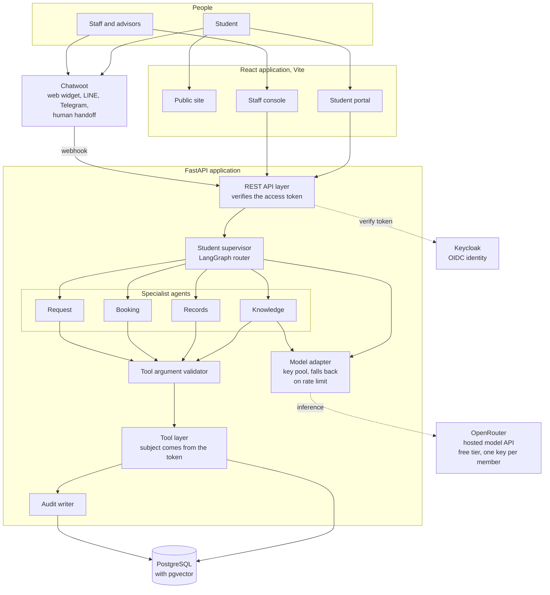
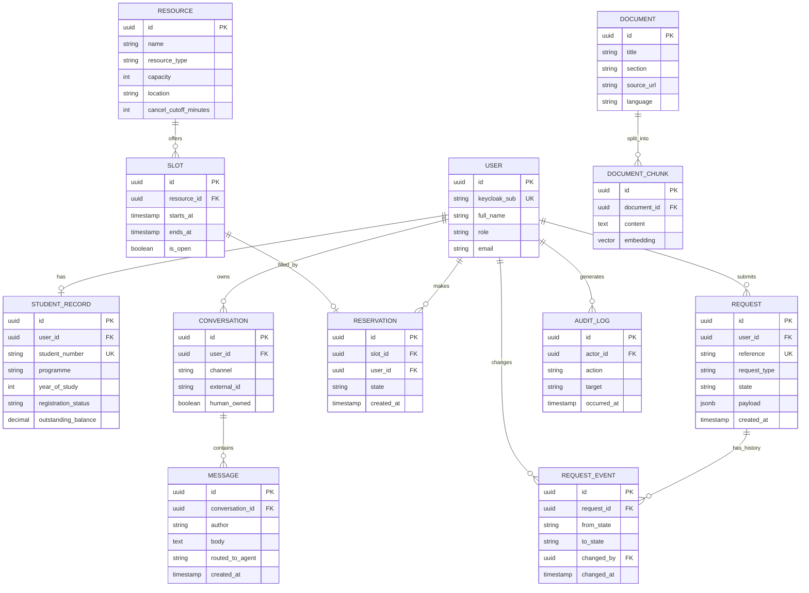
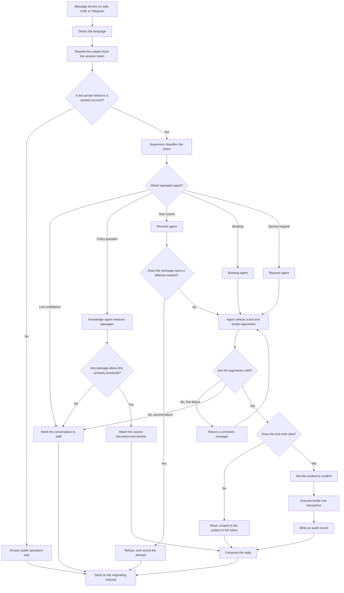

# Smart University Website: Diagram Source

For the three members building diagrams. Workflow for each one:

1. Paste the code block into `mermaid.live`.
2. Export as SVG.
3. Open the SVG in draw.io and restyle it to match the prototype palette.
4. Export a PNG at 2x for the slides.

Diagram 2 has no Mermaid code, because Mermaid does not support use case diagrams. Build that one directly in draw.io with the UML shape library.

---

## 1. Architecture diagram

Three boxes sit outside the FastAPI application: Keycloak, OpenRouter and PostgreSQL. Chatwoot is outside it too. That boundary is what the professor means by showing what is inside the system and what is outside.

The model adapter is worth a sentence of its own. The team holds one OpenRouter free-tier key per member, and the adapter moves to the next key when one hits its rate limit. Changing to a paid provider later means changing settings in that one module.

Note the two paths into the application. The portal and the staff console call the REST API directly. Chat messages arrive through Chatwoot by webhook. Both paths land on the same API layer, and that layer verifies the token.

---

## 2. Use case diagram (draw.io only)

Mermaid has no use case diagram, so build this one by hand. Draw one system boundary box titled **Smart University Website**. Put the four actors outside it.

**Actor: Student.**
- Ask a policy question.
- View own academic record.
- Book a bookable resource.
- Cancel or reschedule own booking.
- Submit a service request.
- Track a service request.
- Ask for a human.

**Actor: Staff.**
- View the work queue.
- Take over a conversation.
- Change a request state.
- Release a conversation back to the assistant.

**Actor: Advisor.**
- Publish availability.
- View own appointments.

**Actor: Administrator.**
- Manage accounts and roles.
- Update the document corpus.
- Read the audit log.

Two relationships are worth drawing. "Ask a policy question" includes "Cite the source document". "Book a bookable resource" includes "Confirm before writing".

---

## 3. ER diagram

Two points to make when presenting this. `SLOT` to `RESERVATION` is one to zero-or-one, and that single constraint is what makes double booking impossible. `DOCUMENT` and `DOCUMENT_CHUNK` carry the source title and section, which is how every answer can cite its rule.

---

## 4. Supervisor routing and tool selection

This is the diagram that answers the professor's requirement to show what we will develop and how. Four branches on it are worth saying out loud in the presentation. The subject always comes from the token, never from the message text. A message naming a different student is refused and recorded. No passage above the threshold means a refusal rather than a guess. Before every write, the agent asks for confirmation, and each write leaves an audit record.
