# Smart University Website: Diagram Source

For the three members who build diagrams. Updated on 17 October 2026 to match the prototype stories S1 to S9, T1 to T4, I1, I2 and A1. Follow these steps for each Mermaid diagram:

1. Paste the code block into `mermaid.live`.
2. Export as SVG.
3. Open the SVG in draw.io and restyle it to match the prototype palette.
4. Export a PNG at 2x for the slides.

The architecture diagram uses the ELK layout, set in the first lines of its code. If your viewer shows a plain layout, turn on ELK in the settings of `mermaid.live`.

The use case diagram has no Mermaid code, because Mermaid does not support use case diagrams. Build that one in draw.io with the UML shape library.

---

## 1. Architecture diagram

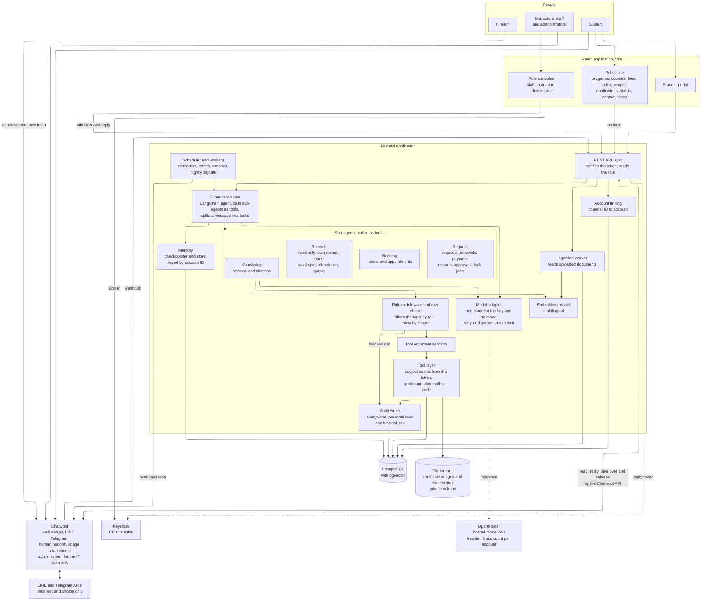

Four boxes sit outside the FastAPI application: Keycloak, OpenRouter, PostgreSQL and Chatwoot. Chatwoot also stays outside it. That boundary shows what is inside the system and what is outside. The Chatwoot admin screen is for the IT team only. Staff handle chats in the staff console, which calls Chatwoot through its API.

Five points are new since the first version.

1. The role from the token selects the tool set. A role middleware filters the tools on each model call. The row check sits between the sub-agents and the tool layer, and it writes every blocked call to the audit log.
2. The scheduler and the workers send messages first. They cover reminders, retries of a failed tool, watches on a request and the nightly signals for instructors.
3. The assistant never reads a payment slip and never decides on money. A student sends the slip in the chat, a staff member checks it in a normal chat and replies by hand, and later asks the assistant to record the payment. The Request agent writes the record after a yes. No payment image goes to OpenRouter.
4. The public site calls the REST API without a login. This serves applications, contact messages and news.
5. The supervisor is one LangChain agent that calls each sub-agent as a tool. Every role uses the same supervisor.

The model adapter holds the OpenRouter key and the model name in settings. OpenRouter counts the free limits for each account, not for each key, so more keys do not add capacity. When the limit is reached, the adapter queues and retries. A paid provider needs new settings in that one module. The assistant sends plain text through Chatwoot to LINE and Telegram. It sends no buttons, no cards and no rich menu there. A student can send a photo, and the assistant never answers with one. The user types yes to agree.

---

## 2. Use case diagram

The diagram is `12_use_case.drawio`. Open it in draw.io to edit it. `12_use_case.svg` and `12_use_case.png` show the same layout. The system boundary is titled Smart University Website. Six actors stand outside it. A role sets the tools and the rows of the assistant, and every write asks for a yes.

**Actor: Guest.** A guest is a visitor with no account, for example an applicant. A guest never uses the assistant.
- Read programs and curriculum, course information, fees and scholarships, rules and policies, faculties and people.
- Search the library catalogue.
- Apply for a program, check the application status and send a contact message.

**Actor: Student.**
- Ask a policy question.
- View the own record, grades and timetable.
- Renew a library loan.
- Book a room or an appointment, and cancel or move a booking.
- Submit and track a request, send a payment slip and send a file for a request.
- Plan grades and graduation, and watch a request.
- Continue a chat on another day, receive a reminder and ask for a person.

**Actor: Instructor.**
- View the own appointments and advisees, and read the advising brief.
- Review advisee signals and approve a study plan.
- Move an appointment and publish availability.
- Check the attendance of the own course and send an absence warning.

**Actor: Staff.**
- View the sorted queue, take over a chat and release it.
- Read the handoff summary and draft.
- Approve or change a request, check a payment slip in the chat and ask the assistant to record the payment.
- Send a bulk reminder, and ask the assistant about the queue.

**Actor: Administrator.**
- Manage accounts and roles, and create accounts from a file.
- Upload documents, read the questions without an answer and resolve sources that disagree.
- Read the system status, the audit log and the blocked calls.

**Actor: IT team.** The IT team runs the platform. It is not a role in the application.
- Manage the Chatwoot inboxes and channels.
- Set up the Chatwoot bot and agents.
- Sign in to Chatwoot with its own login, because Chatwoot has no Keycloak sign-in.

Every role also does everything a guest does. Four relationships are in the note box of the diagram. Every use case with the assistant includes the role and row check. A policy answer includes the source citation. Every write includes the confirmation and the audit record. A person decides every payment slip, and the record is written only after a yes.

---

## 3. ER diagram

```mermaid
erDiagram
  USER ||--o| STUDENT_RECORD : has
  USER ||--o{ CONVERSATION : owns
  USER ||--o{ RESERVATION : makes
  USER ||--o{ REQUEST : submits
  USER ||--o{ AUDIT_LOG : generates
  CONVERSATION ||--o{ MESSAGE : contains
  RESOURCE ||--o{ SLOT : offers
  SLOT ||--o| RESERVATION : filled_by
  REQUEST ||--o{ REQUEST_EVENT : has_history
  USER ||--o{ REQUEST_EVENT : changes
  DOCUMENT ||--o{ DOCUMENT_CHUNK : split_into
  BOOK ||--o{ LOAN : lent_as
  USER ||--o{ LOAN : borrows
  USER ||--o{ CHARGE : owes
  CHARGE ||--o{ PAYMENT : paid_by
  USER ||--o{ PAYMENT : records
  PAYMENT }o--o| CONVERSATION : proven_in
  USER ||--o{ MEMORY_FACT : remembered_for
  CONVERSATION ||--o{ MEMORY_FACT : source_of
  RESERVATION ||--o| ADVISOR_BRIEF : prepared_for
  UNANSWERED_QUESTION }o--o| DOCUMENT : closed_by
  COURSE ||--o{ ENROLLMENT : has
  USER ||--o{ ENROLLMENT : takes
  COURSE ||--o{ CLASS_SESSION : meets_as
  CLASS_SESSION ||--o{ ATTENDANCE : records
  USER ||--o{ ATTENDANCE : attends
  USER ||--o{ ADVISOR_LINK : advises
  USER ||--o{ ADVISOR_LINK : advised_by
  USER ||--o{ NOTIFICATION : receives
  MESSAGE ||--o| FEEDBACK : rated_by
  USER ||--o{ WATCH : asks_for
  REQUEST ||--o{ WATCH : watched_by
  USER ||--o{ PENDING_QUESTION : waits_for
  DOCUMENT ||--o{ SOURCE_CONFLICT : disagrees_in
  USER ||--o{ CHANNEL_LINK : links
  REQUEST ||--o{ REQUEST_FILE : has
  REQUEST ||--o{ AGENT_CHECK : checked_by
  REQUEST }o--o| CONVERSATION : started_in
  USER ||--o{ STUDY_PLAN : follows
  USER ||--o{ STUDY_PLAN : approves
  USER ||--o{ ADVISEE_SIGNAL : flagged
  USER ||--o{ ADVISEE_SIGNAL : reviews
  MESSAGE ||--o{ TRACE_STEP : traced_by
  FACULTY ||--o{ PROGRAM : runs
  PROGRAM ||--o{ PROGRAM_COURSE : lists
  COURSE ||--o{ PROGRAM_COURSE : appears_in
  USER ||--o| STAFF_PROFILE : described_by
  FACULTY ||--o{ STAFF_PROFILE : employs
  APPLICATION }o--|| PROGRAM : applies_to

  USER {
    uuid id PK
    string keycloak_sub UK
    string full_name
    string role
    string email
    string account_state
  }
  STUDENT_RECORD {
    uuid id PK
    uuid user_id FK
    string student_number UK
    string programme
    int year_of_study
    string registration_status
    decimal outstanding_balance
    string account_hold
  }
  RESOURCE {
    uuid id PK
    string name
    string resource_type
    int capacity
    string location
    int cancel_cutoff_minutes
  }
  SLOT {
    uuid id PK
    uuid resource_id FK
    timestamp starts_at
    timestamp ends_at
    boolean is_open
  }
  RESERVATION {
    uuid id PK
    uuid slot_id FK
    uuid user_id FK
    string state
    timestamp created_at
  }
  REQUEST {
    uuid id PK
    uuid user_id FK
    string reference UK
    string request_type
    string state
    jsonb payload
    timestamp created_at
    int priority
    string priority_reason
    uuid source_conversation_id FK
  }
  REQUEST_EVENT {
    uuid id PK
    uuid request_id FK
    string from_state
    string to_state
    uuid changed_by FK
    timestamp changed_at
  }
  CONVERSATION {
    uuid id PK
    uuid user_id FK
    string channel
    string external_id
    int chatwoot_conversation_id
    boolean human_owned
    uuid owner_staff_id FK
    timestamp escalated_at
    text escalation_summary
    text draft_reply
  }
  MESSAGE {
    uuid id PK
    uuid conversation_id FK
    string author
    text body
    string routed_to_agent
    timestamp created_at
  }
  DOCUMENT {
    uuid id PK
    string title
    string section
    string source_url
    string language
    string state
    int pages_read
    int sections_indexed
    int pages_failed
    boolean is_public
  }
  DOCUMENT_CHUNK {
    uuid id PK
    uuid document_id FK
    text content
    vector embedding
  }
  AUDIT_LOG {
    uuid id PK
    uuid actor_id FK
    string action
    string target
    string outcome
    timestamp occurred_at
    string actor_role
    string channel
  }
  BOOK {
    uuid id PK
    string title
    string author
    string isbn UK
    string call_number
    string shelf_location
    int copies_total
    int copies_available
  }
  LOAN {
    uuid id PK
    uuid book_id FK
    uuid user_id FK
    date due_on
    int renewals
  }
  CHARGE {
    uuid id PK
    uuid user_id FK
    string description
    decimal amount
    date due_on
    string state
  }
  PAYMENT {
    uuid id PK
    uuid charge_id FK
    uuid recorded_by FK
    uuid conversation_id FK
    decimal amount
    string state
    string reason
    timestamp recorded_at
  }
  MEMORY_FACT {
    uuid id PK
    uuid user_id FK
    uuid conversation_id FK
    string topic
    text content
    timestamp saved_at
  }
  ADVISOR_BRIEF {
    uuid id PK
    uuid reservation_id FK
    text content
    timestamp updated_at
  }
  UNANSWERED_QUESTION {
    uuid id PK
    uuid document_id FK
    text question
    int times_asked
    string state
    timestamp last_asked_at
    vector question_embedding
  }

  COURSE {
    uuid id PK
    string code UK
    string title
    int credits
    uuid instructor_id FK
    string room
    string schedule
    text description
    string prerequisite_text
  }
  ENROLLMENT {
    uuid id PK
    uuid course_id FK
    uuid user_id FK
    string term
    string grade
    boolean counts_in_average
  }
  CLASS_SESSION {
    uuid id PK
    uuid course_id FK
    timestamp starts_at
    string kind
  }
  ATTENDANCE {
    uuid id PK
    uuid session_id FK
    uuid user_id FK
    string status
    int minutes_late
  }
  ADVISOR_LINK {
    uuid id PK
    uuid advisor_id FK
    uuid advisee_id FK
  }
  NOTIFICATION {
    uuid id PK
    uuid user_id FK
    string title
    text body
    boolean is_read
    timestamp created_at
    string kind
  }
  FEEDBACK {
    uuid id PK
    uuid message_id FK
    boolean helpful
    timestamp created_at
  }
  WATCH {
    uuid id PK
    uuid user_id FK
    uuid request_id FK
    string channel
    boolean active
  }
  PENDING_QUESTION {
    uuid id PK
    uuid user_id FK
    uuid conversation_id FK
    text question
    int retries
    timestamp next_try_at
  }
  SOURCE_CONFLICT {
    uuid id PK
    uuid document_a FK
    uuid document_b FK
    text passage_a
    text passage_b
    string state
  }
  APPLICATION {
    uuid id PK
    string reference UK
    string applicant_name
    string email
    uuid program_id FK
    string intake
    string state
  }
  CONTACT_MESSAGE {
    uuid id PK
    string name
    string email
    string topic
    text body
    timestamp created_at
  }
  CONTENT_ITEM {
    uuid id PK
    string kind
    string title
    text body
    date published_on
  }

  CHANNEL_LINK {
    uuid id PK
    uuid user_id FK
    string channel
    string external_id UK
    int chatwoot_contact_id
    timestamp linked_at
  }
  REQUEST_FILE {
    uuid id PK
    uuid request_id FK
    string storage_path
    string mime_type
    timestamp keep_until
  }
  AGENT_CHECK {
    uuid id PK
    uuid request_id FK
    string name
    string result
    text detail
  }
  STUDY_PLAN {
    uuid id PK
    uuid student_id FK
    uuid advisor_id FK
    jsonb terms
    string state
    timestamp updated_at
    timestamp approved_at
  }
  ADVISEE_SIGNAL {
    uuid id PK
    uuid advisee_id FK
    uuid advisor_id FK
    string rule
    text evidence
    string state
  }
  TRACE_STEP {
    uuid id PK
    uuid message_id FK
    string agent
    string tool
    string status
    int duration_ms
  }
  MODEL_USAGE {
    uuid id PK
    string key_label
    timestamp hour
    int requests
    int rate_limit_hits
  }
  EVAL_RUN {
    uuid id PK
    date ran_on
    int questions
    decimal score
  }

  FACULTY {
    uuid id PK
    string name
    text summary
  }
  PROGRAM {
    uuid id PK
    uuid faculty_id FK
    string name
    string level
    int years
    int credits_total
    decimal tuition_per_semester
    decimal application_fee
    date application_deadline
    string intake_month
  }
  PROGRAM_COURSE {
    uuid id PK
    uuid program_id FK
    uuid course_id FK
    int year
    int semester
    string kind
  }
  STAFF_PROFILE {
    uuid id PK
    uuid user_id FK
    uuid faculty_id FK
    string title
    string research_area
    string office
  }
```

When you present this, make four points.

1. `SLOT` to `RESERVATION` is one to zero-or-one. That single constraint makes a double booking impossible.
2. `DOCUMENT` and `DOCUMENT_CHUNK` carry the source title and section. This is how every answer cites its rule.
3. `CHANNEL_LINK` joins a LINE or Telegram ID to one account. This is how the same student is known on web, LINE and Telegram.
4. `AGENT_CHECK`, `AUDIT_LOG` and `TRACE_STEP` hold the work of the agents. A person can read each step.

`APPLICATION`, `CONTACT_MESSAGE`, `CONTENT_ITEM`, `MODEL_USAGE` and `EVAL_RUN` have no link to a user. They serve the public site and the system status page.

---

## 4. Supervisor routing and tool selection

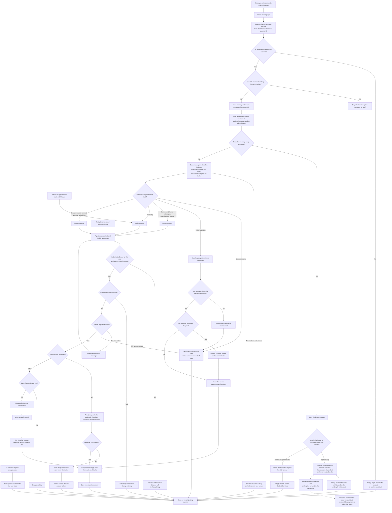

This diagram shows what we develop and how. Six branches are worth saying out loud in the presentation.

1. The subject always comes from the token, never from the message text.
2. The role middleware selects the tool set, and the row check stops a call outside the role. The call goes to the audit log as a blocked call.
3. No passage above the threshold means a refusal and a handoff, never a guess.
4. Before every write, the agent asks for a yes. Each write leaves an audit record.
5. A payment slip goes to Student Services. The assistant stays silent and never reads the slip. A person checks it and replies by hand, then asks the assistant to record the payment.
6. A tool that fails does not end the chat. The question is saved. When the tool works again, the assistant answers.

---

## 5. Sequence: one chat message from LINE to the reply

File: `04_sequence_message.mmd`.

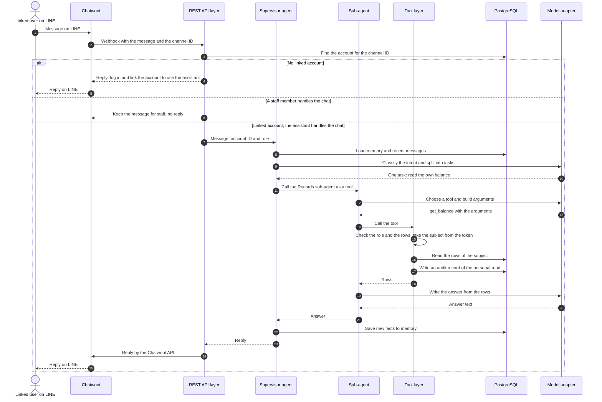

The diagram shows three branches at the REST API layer. A sender without a linked account gets a reply that asks for a login. A conversation that a staff member handles gets no reply. Every other message reaches the supervisor agent.

---

## 6. Sequence: two students and one slot

File: `05_sequence_booking.mmd`.

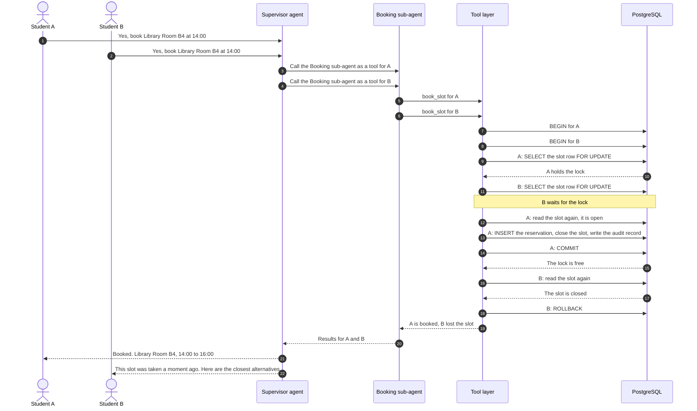

This is the same story as the prototype frames of story S6. A row lock and a second read make a double booking impossible.

---

## 7. State diagrams

Four state diagrams show the engines. Each file holds one diagram.

### 7.1 Request, file `06_state_request.mmd`

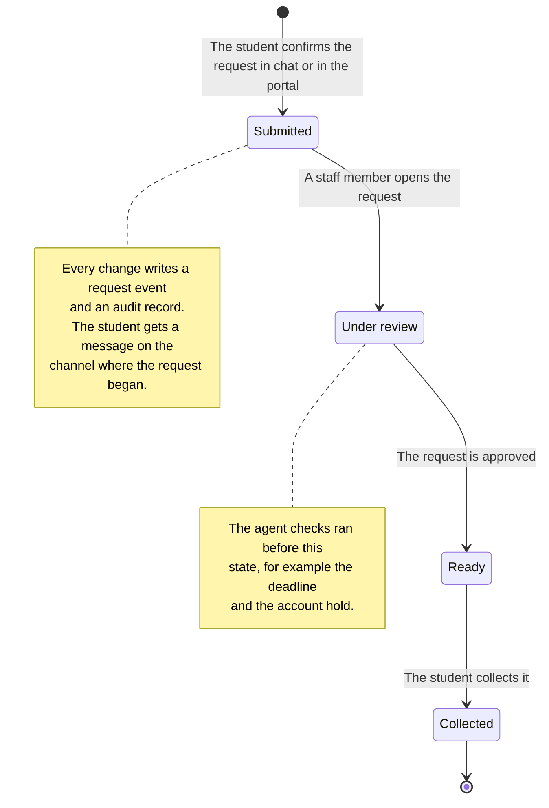

### 7.2 Charge and payment record, file `07_state_payment_check.mmd`

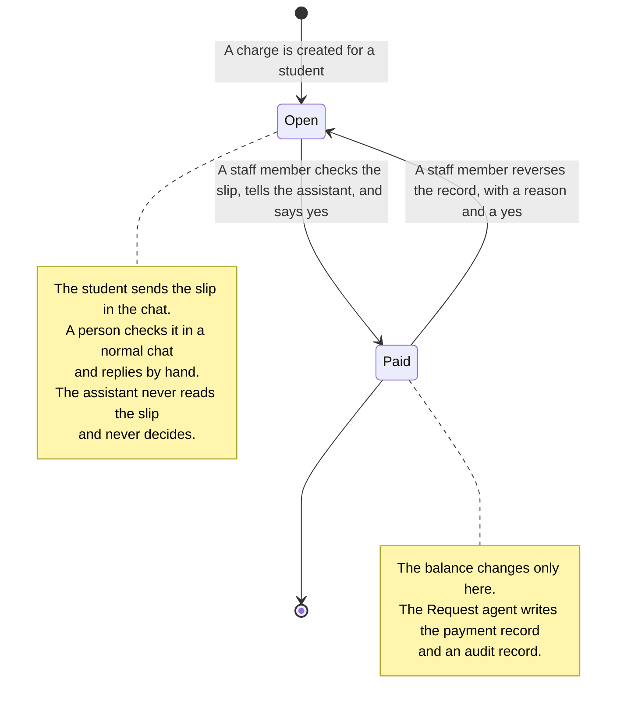

### 7.3 Conversation owner, file `08_state_conversation.mmd`

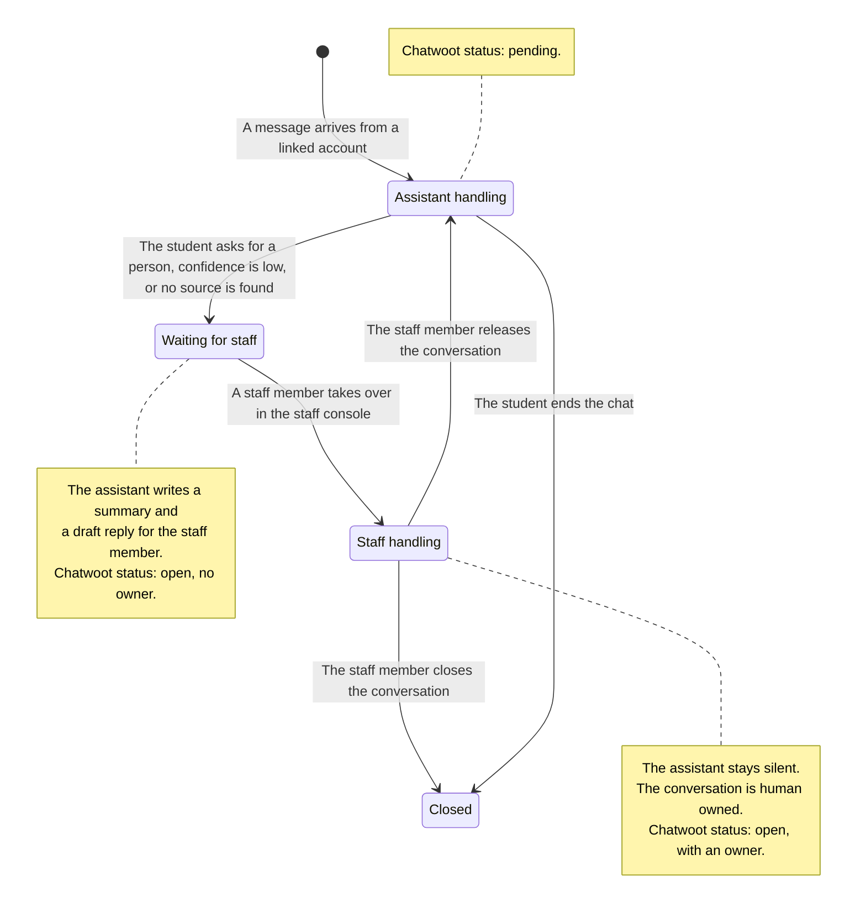

### 7.4 Reservation, file `09_state_reservation.mmd`

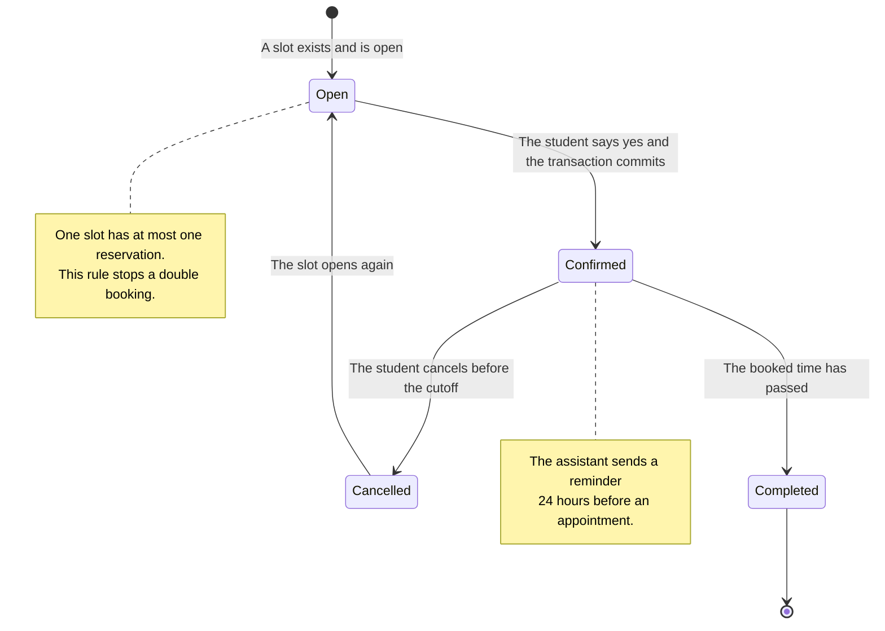

---

## 8. Deployment

File: `10_deployment.mmd`. It uses the ELK layout.

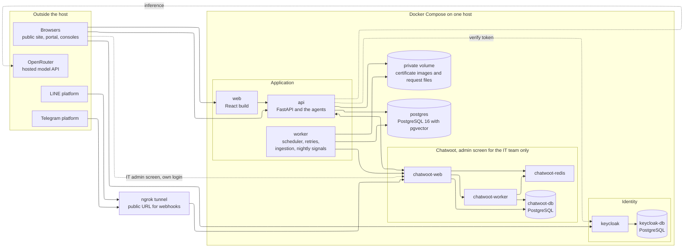

One Docker Compose file starts every container on one host. An ngrok tunnel gives LINE and Telegram a public address for the webhook. The team decides the production database later. Chatwoot has its own admin screen, and only the IT team opens it.

---

## 9. Access map

File: `11_access_map.mmd`. It uses the ELK layout.

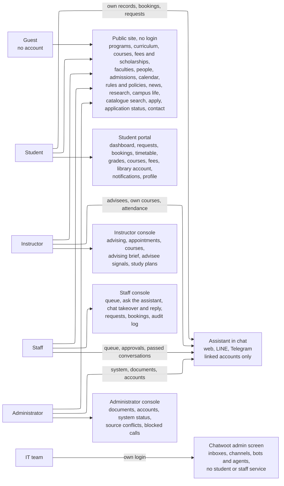

Every role reaches the public site without a login. The assistant in chat serves linked accounts only. A guest never uses the assistant. The IT team reaches only the Chatwoot admin screen.
